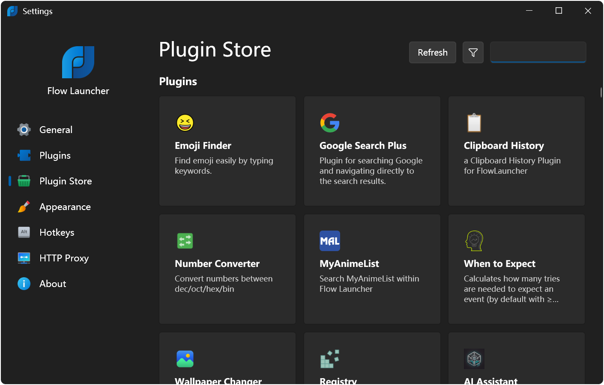

# Flow Launcher Keyboard Search for Windows Workflows

Need an app, a document, and a quick calculation without reaching for three different menus?
Flow Launcher Everything integration brings indexed filename search into Flow Launcher, alongside application launching and other keyboard actions.
Use flow launcher plugins to add services, flow launcher themes to tune readability, and the flow launcher plugin store to discover extensions.

## From a query to the next action

Press **Alt+Space**, type what you need, select a result with the arrow keys, and press **Enter**.
The activation shortcut is configurable, so you can choose another combination when it conflicts with an existing tool.

- Enter an application name to find a program.
- Search for a document by name instead of browsing its folder tree.
- Open a bookmark or send a query to your preferred search engine.
- Inspect a result's context menu when you need an alternative action.

The input model in [Query.cs](Flow.Launcher.Plugin/Query.cs) distinguishes the original input from the search passed to a plugin.
A keyword can direct the query to a particular plugin; [QueryBuilderTest.cs](Flow.Launcher.Test/QueryBuilderTest.cs) exercises this routing.
The result model in [Result.cs](Flow.Launcher.Plugin/Result.cs) gives each match a title and optional supporting text.

[](https://flow-launcher-everything.github.io/Flow-Launcher/)

## Choose how your files are found

The Explorer plugin supports Everything and Windows Index.
Choose a search backend according to what you remember about the file, rather than expecting every backend to search the same information.

| Search question | Everything | Windows Index |
| --- | --- | --- |
| Remember part of a filename? | Designed for indexed name lookup | Can find names within indexed locations |
| Remember words inside a document? | Filename lookup alone does not search document text | Can use indexed contents where supported |
| Searching an unindexed location? | Check Everything's indexing coverage | Check Windows indexing scope |
| Newly added files are missing? | Check that the Everything index includes them | Check indexing status and location coverage |

Everything is a separate Windows search engine from voidtools.
Its index must cover the location you want to search.
File content support through Windows Index also depends on the file type and indexing configuration.


For a missing result, try the exact filename in the selected backend first.
If the backend cannot find it, adjusting launcher result priorities will not expand its index.
Windows Index query behavior is covered by [ExplorerTest.cs](Flow.Launcher.Test/Plugins/ExplorerTest.cs).
Shared file and folder operations are collected in [FilesFolders.cs](Flow.Launcher.Plugin/SharedCommands/FilesFolders.cs).

## Calculate, browse, or run a command

### Keep a calculation beside your work

Type an expression in the search window and inspect the calculated result.
These are separate example queries, entered one at a time:

```text
(240 + 60) / 12
85 * 1.2
144 / 16
```

Copy the result when you need it in a document or message.
Locale-sensitive formatting and calculator behavior are exercised in [CalculatorTest.cs](Flow.Launcher.Test/Plugins/CalculatorTest.cs).

### Move between local and web tasks

Application launching, browser bookmarks, and web queries use different plugins.
Review the selected result before opening it when similar names appear in several sources.
The supplied [ProgramPluginTest.cs](Flow.Launcher.Test/Plugins/ProgramPluginTest.cs) covers program-plugin behavior.
URL handling has a separate test fixture in [UrlPluginTest.cs](Flow.Launcher.Test/Plugins/UrlPluginTest.cs).

### Use the shell deliberately

The Shell plugin accepts the default action keyword **>**.
For example, enter either of these queries to ask Windows Command Prompt for information or display a message:

```text
> cmd /c ver
> cmd /c echo Ready for the next task
```

Here, **>** selects Flow's Shell plugin, while **cmd /c** belongs to Windows Command Prompt.
Shell selection and argument handling are covered by [ShellPluginTest.cs](Flow.Launcher.Test/Plugins/ShellPluginTest.cs).
Shared process-launching helpers are in [ShellCommand.cs](Flow.Launcher.Plugin/SharedCommands/ShellCommand.cs).

## Extend a task with a plugin

Browse the Plugin Store in Settings when a repeated task needs another search source or action.
Choose an extension for the service you actually use, then review its description, action keyword, and requirements.
Window switching extensions, for example, serve a different purpose from searching files with Everything.

Plugin identity and version information are represented by [PluginMetadata.cs](Flow.Launcher.Plugin/PluginMetadata.cs).
[PluginInstallerTest.cs](Flow.Launcher.Test/PluginInstallerTest.cs) exercises installer behavior, while [PluginLoadTest.cs](Flow.Launcher.Test/PluginLoadTest.cs) covers loading.

### Shape the result a user sees

A plugin can provide a concise result with enough detail to distinguish it from another match.
This C# fragment constructs one result inside a plugin project referencing Flow's API:

```csharp
var result = new Flow.Launcher.Plugin.Result
{
    Title = "Review today's notes",
    SubTitle = "Return to your daily writing task"
};
```

This creates display data; opening a note requires the plugin to supply the corresponding action.
Synchronous query implementations use [IPlugin.cs](Flow.Launcher.Plugin/Interfaces/IPlugin.cs).
For asynchronous work, [IAsyncPlugin.cs](Flow.Launcher.Plugin/Interfaces/IAsyncPlugin.cs) includes cancellation support.
Initialization receives [PluginInitContext.cs](Flow.Launcher.Plugin/PluginInitContext.cs).
Additional result actions are exposed through [IContextMenu.cs](Flow.Launcher.Plugin/Interfaces/IContextMenu.cs).

## Make the search window comfortable

Prioritize readable text and enough room for useful result details before adding visual effects.
Flow supports appearance changes, window sizing, and configurable hotkeys.
Use **F1** to show or hide the preview panel when the selected result provides a preview.



Theme metadata is represented by [ThemeData.cs](Flow.Launcher.Plugin/SharedModels/ThemeData.cs).
Theme preview behavior is exercised by [ThemePreviewTest.cs](Flow.Launcher.Test/ThemePreviewTest.cs).
Result navigation is covered by [ResultsViewModelNavigationTest.cs](Flow.Launcher.Test/ResultsViewModelNavigationTest.cs).

- Choose contrasting text and selection colors for your display.
- Check longer filenames before settling on a narrow window.
- Keep the activation shortcut distinct from shortcuts used by other launchers.
- Use Game Mode when you want to pause hotkey activation during games.

Game Mode can be toggled with **Ctrl+F12** while the search window is active.
For portable use, locate your actual settings folder through the **flow user data** query.
Preserve that folder when moving your preferences to another machine.

## About the supplied source snapshot

The supplied materials contain Flow Launcher plugin API files and tests, but omit the main application and built-in plugin implementations.
They support inspection of contracts and test scenarios; this snapshot alone is not a complete runnable launcher checkout.
The API project definition is [Flow.Launcher.Plugin.csproj](Flow.Launcher.Plugin/Flow.Launcher.Plugin.csproj).
The test project definition is [Flow.Launcher.Test.csproj](Flow.Launcher.Test/Flow.Launcher.Test.csproj).
Neither the examples nor the supplied tests were executed for this document.

## Related Search Terms

Flow Launcher Everything, Flow Launcher, flow launcher plugins, flow launcher themes, flow launcher plugin store, flow-launcher, application-launcher, keyboard-launcher, launcher, search, plugins, productivity, windows, portable, desktop
